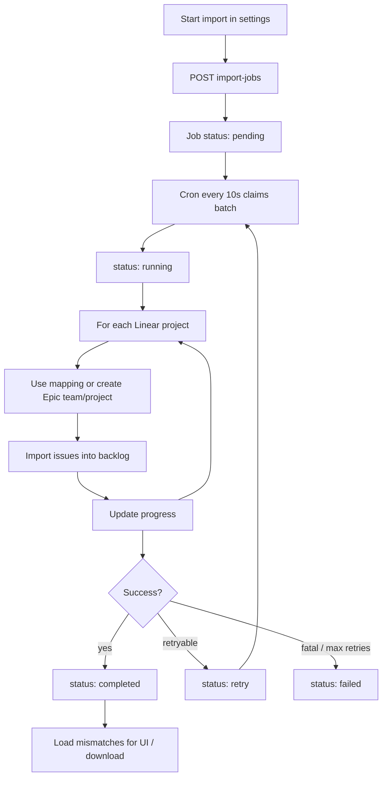

# Linear integration — features & workflows

Inspection guide for Epicstory’s Linear integration (as implemented in code).

**Nature:** one-way **OAuth connect** + **one-shot import** of Linear projects/issues into an Epicstory workspace.  
**Not:** live sync, webhooks, or writes back to Linear.

**Settings UI:** `/:workspaceId/settings/integrations/linear`  
**Code root:** `api/src/integrations/linear/`

---

## What it does

| Feature | Status |
|--------|--------|
| Connect a Linear org to a workspace (OAuth, `read` scope) | Yes |
| List Linear projects for import | Yes |
| Background import: teams → projects → issues → assignees | Yes |
| Map a Linear project onto an **existing** Epicstory project | Yes (optional, per selected project) |
| Idempotent re-import (skip already-mapped issues) | Yes |
| Record non-fatal mismatches (unmatched users, missing projects, …) | Yes |
| Push changes to Linear / bidirectional sync | **No** |
| Webhooks / incremental updates after import | **No** |
| Import comments, labels, attachments, cycles, relations, sub-issues | **No** |
| Token refresh using stored refresh token | **No** (stored but unused) |

UI copy: *“Connect a Linear workspace, select projects, and import issues into your Epicstory backlog.”*

---

## End-to-end workflows

### A. Connect Linear (OAuth)

```mermaid
sequenceDiagram
  participant User
  participant App as Epicstory app
  participant API as Epicstory API
  participant Linear as Linear OAuth

  User->>App: Settings → Integrations → Linear → Connect
  App->>API: GET /integrations/linear/oauth/start?workspaceId&redirect
  API->>API: Check workspace membership; set httpOnly cookies
  API->>Linear: Redirect authorize (scope=read)
  Linear->>API: GET .../oauth/callback?code&state
  API->>Linear: Exchange code for tokens
  API->>API: Encrypt tokens; upsert linear_connections
  API->>App: Redirect to settings page
```

**Who can connect:** any workspace member (admin-only gate is not enforced yet).

**Tokens:** encrypted at rest (`INTEGRATIONS_ENCRYPTION_KEY`). Connection GET responses never include token fields.

**Disconnect:** `DELETE .../connection` revokes the token at Linear (best-effort), then hard-deletes the Epicstory connection (related maps/jobs cascade).

**Reconnect consent:** authorize URL always includes `prompt=consent`, so Connect shows Linear’s consent screen even if the user previously granted access.

### B. Import projects & issues



**UI steps**

1. Connect Linear (if needed).
2. Review the project list; **Select all** or pick projects. Set **Destination** per row (Auto-create or map to an Epicstory project).
3. **Start import** (enabled when selection is non-empty) → poll until `completed` / `failed`; toasts report outcome including created vs mapped.
4. Review destination summary and mismatches (grouped by type); optional **Download JSON**.

**Job statuses:** `pending` → `running` → `completed` | `retry` | `failed`  
**Cron:** every 10s, batch size 5, max 5 retries with exponential backoff.

### C. What gets imported (per Linear project)

1. Resolve Linear project (mismatch if missing).
2. If mapped to an Epic project: validate workspace ownership; upsert `linear_project_map`; import issues.
3. Else:
   - Resolve Linear team → Epic team (reuse map or `CreateTeam`).
   - Import team members by **email** (`AddTeamMember`); record mismatches when email/workspace membership fails.
   - Create Epic project (`CreateProject`) and map it.
4. **Issues** (paginated, sorted by Linear `sortOrder` then `createdAt`):
   - Skip if already in `linear_issue_map` (**no update** of existing Epic issues).
   - Else create backlog item (title + markdown→TipTap description), map issue, set status/dueDate/priority, assign if assignee email matches a workspace member.

**Linear state → Epic status**

| Linear (approx.) | Epicstory |
|------------------|-----------|
| complete / done | `done` |
| start / in progress | `doing` |
| backlog / todo / default | `todo` |

---

## Data model (`integration` schema)

| Table | Role |
|-------|------|
| `linear_connections` | Workspace↔Linear org + encrypted tokens (`status: active`) |
| `linear_team_map` | Linear team → Epic team |
| `linear_project_map` | Linear project → Epic project |
| `linear_issue_map` | Linear issue → Epic issue + backlog item |
| `linear_user_map` | Linear user → Epic user (nullable) + email snapshot |
| `linear_import_jobs` | Queued import work + `params` / `progress` / lock / retries |
| `linear_import_mismatches` | Non-fatal problems for a job (`type`, `message`, `payload`) |

Migration: `api/src/core/migrations/1770851779617-MigrationAddLinearIntegrationTables.ts`

### Mismatch types (job still completes)

| `type` | Meaning |
|--------|---------|
| `linear_project_not_found` | Linear project id not loadable |
| `mapped_epic_project_not_found` | Mapped Epic project missing |
| `mapped_epic_project_wrong_workspace` | Mapped project outside workspace |
| `unmatched_user` | Team member email not in Epicstory |
| `user_not_workspace_member` | User exists but not in workspace |
| `no_team_for_project` | No team map and no default team |
| `missing_backlog` | Epic project has no backlog |
| `unmatched_assignee` | Assignee email not found |
| `assignee_not_workspace_member` | Assignee not in workspace |

---

## API surface

| Method | Path | Notes |
|--------|------|--------|
| `GET` | `/integrations/linear/oauth/start` | JWT; redirects to Linear |
| `GET` | `/integrations/linear/oauth/callback` | Cookie/`state`; redirects to app |
| `GET` | `/integrations/linear/workspaces/:workspaceId/connection` | Connection or null |
| `DELETE` | `/integrations/linear/workspaces/:workspaceId/connection` | Disconnect |
| `GET` | `/integrations/linear/workspaces/:workspaceId/teams` | Exists; **not** in api-client UI |
| `GET` | `/integrations/linear/workspaces/:workspaceId/projects` | List Linear projects |
| `GET` | `/integrations/linear/workspaces/:workspaceId/project-maps` | Existing Linear↔Epic project links |
| `POST` | `/integrations/linear/workspaces/:workspaceId/import-jobs` | Body: `{ importAll?, projectIds?, mappings? }` |
| `GET` | `/integrations/linear/workspaces/import-jobs/:jobId` | Job status/progress |
| `GET` | `/integrations/linear/workspaces/import-jobs/:jobId/mismatches` | Mismatch list |

Client: `packages/api-client/src/linear.api.ts`  
Contracts: `packages/contracts/src/linear.ts`

---

## Frontend

| Piece | Location |
|-------|----------|
| Settings page | `app/src/views/workspace/LinearIntegration.vue` |
| Nav link | `app/src/containers/navbar/SettingsNavbar.vue` → **Linear** |
| Route | `linear-integration-settings` in `app/src/app/router.ts` |
| Domain module | `app/src/domain/integrations/linear/` (placeholder / empty) |

### Settings UX (dogfood)

- **Project list always visible** after connect, with a **count** / selection count and empty state (“No Linear projects found”).
- **Select all / Clear** instead of a separate “Import all” mode — every selected row has a **Destination**.
- **Destination:** Auto-create or map to an existing Epicstory project. Help copy: *Map to reuse an Epicstory project; Auto-create makes a new one.*
- **Suggestions:** name similarity pre-fills Destination when confident; existing `linear_project_map` rows pre-select the linked Epic project.
- **Warnings:** if the chosen Epic project (or Linear project) is already linked to a different partner, show an inline amber warning.
- **Defaults:** Start import disabled until at least one project is selected.
- **Errors are transient:** command failures use **vue-sonner** toasts — no sticky page error banner.
- **Progress:** human summary (`importedProjects` / `importedIssues` / `lastProject`) plus **created vs mapped** outcomes after import; auto-poll only.
- **Mismatches:** grouped by `type` with counts; JSON download retained.
- **Disconnect:** confirm dialog; revokes Linear token then deletes connection. Reconnect uses `prompt=consent`.

`GET /integrations/linear/workspaces/:workspaceId/project-maps` returns existing `{ linearProjectId, epicProjectId }` links for warnings and prefill.

---

## Configuration

| Env | Purpose |
|-----|---------|
| `LINEAR_CLIENT_ID` | OAuth app client id |
| `LINEAR_CLIENT_SECRET` | OAuth app secret |
| `LINEAR_CALLBACK_URI` | e.g. `https://…/api/integrations/linear/oauth/callback` |
| `INTEGRATIONS_ENCRYPTION_KEY` | AES key for tokens (shared with other integrations) |
| `APP_URL` | Post-OAuth browser redirect base |

---

## Key backend files

| File | Purpose |
|------|---------|
| `linear.module.ts` | Nest wiring |
| `controllers/linear-oauth.controller.ts` | OAuth start/callback |
| `controllers/linear-connection.controller.ts` | Get / disconnect |
| `controllers/linear-import.controller.ts` | Teams, projects, jobs, mismatches |
| `services/linear-oauth.service.ts` | Authorize URL + token exchange |
| `services/linear-api.service.ts` | List teams/projects with decrypted token |
| `services/linear-import-processor.service.ts` | Import orchestration |
| `jobs/linear-import.cronjob.ts` | Claim + process jobs |
| `entities/*` | Connection, maps, jobs, mismatches |

---

## How to inspect manually

1. Open `/{workspaceId}/settings/integrations/linear`.
2. Connect Linear (needs env OAuth vars configured).
3. Run a small import (one project, optionally mapped).
4. Watch job status/progress; open mismatches / download JSON.
5. Confirm Epicstory projects/issues appear; re-run import and confirm mapped issues are skipped (not updated).
6. Disconnect and confirm connection (and cascaded maps) are removed.

---

## Related product notes

- Product README points at GitHub deep-spec under `.tasks/github-integration/`; this folder is the Linear counterpart.
- Linear-**style** description comments (gutter) are a separate product feature — see `.product/tasks/11-description-comments-suggestions.md` — not part of this Linear.org API integration.
